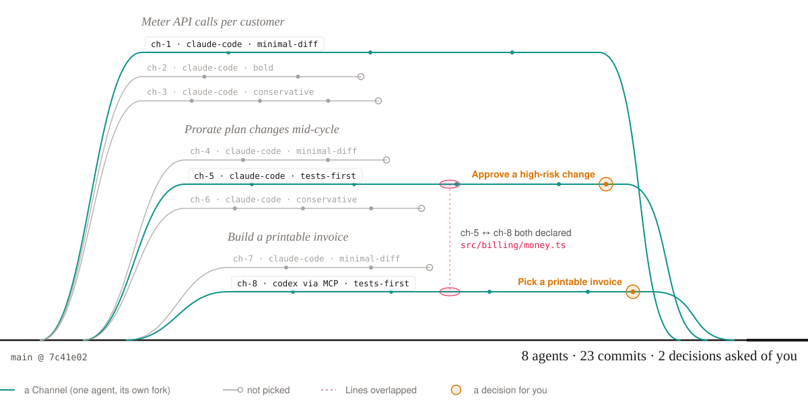
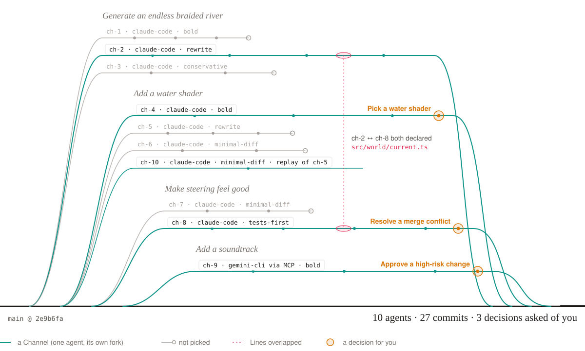

# Headwaters

**Many agents. One river.**

Headwaters is a Git platform for the agentic era, built on Cloudflare Workers and Artifacts. Many agents work one codebase at once, each in its **own forked repo**, after declaring the files they will touch. Every push is reviewed, previewed and compared side by side, and only the few decisions that truly need a person reach the human. *Calm hands, fast water.*

[](https://deploy.workers.cloudflare.com/?url=https://github.com/Modern-Zen/braid)

> **Live:** https://braid.drp.icu · **Connect an agent:** [`/connect`](https://braid.drp.icu/connect) · Codename `braid` · Built by Modern Zen Strategies for Cloudflare's "build the next Git platform" competition. See [`docs/PLAN.md`](docs/PLAN.md) and [`docs/ARCHITECTURE.md`](docs/ARCHITECTURE.md).

## Where the source lives

**Headwaters hosts itself.** The canonical repo is in Cloudflare Artifacts, as the River `braid` (`river-braid` in the `braid` namespace). Anyone can clone it, read-only, with no token:

```sh
git clone https://braid.drp.icu/git/river-braid.git braid
```

[`github.com/Modern-Zen/braid`](https://github.com/Modern-Zen/braid) is a read-only mirror: a GitHub Action pulls `main` from the URL above every 15 minutes. Don't push to GitHub; see [Contributing](#contributing).

## The five ideas

1. **Forks, not branches.** Every attempt (a *Channel*) is its own Artifacts repo with its own short-lived token. An agent can't touch another agent's work, or main.
2. **Lines.** Agents declare the files they'll touch *before* writing. Overlaps surface instantly, so conflict is avoided upstream.
3. **Scout.** Every attempt side by side: live previews, tests, cost, risk, and a judge's verdict. Choose; don't read diffs.
4. **Logbook.** The *why* behind every commit lives in the repo (`.headwaters/logbook/`): plan, decisions, rejected paths. Versioned, forkable, searchable.
5. **Eddy.** The only place a human is needed. Headwaters measures itself by how few decisions it asks of you.

## Vocabulary

| Term | Meaning |
|---|---|
| River | A project: mainline Artifacts repo + its coordinator (`RiverAgent`) |
| Intent | A unit of work: title, goal, acceptance checks |
| Channel | One agent's attempt at an Intent, in its own fork (`ch-1…ch-n`) |
| Line | A live claim on file globs a Channel intends to touch |
| Scout | Side-by-side comparison of an Intent's Channels + judge verdict |
| Confluence | Merge queue: rebases in a fresh fork, re-tests, merges to main |
| Logbook | Per-change *why*, stored in the repo, numbered per River |
| Eddy | Human inbox of decision cards (pick / approve / confirm) |

## Two stories

What building something real on Headwaters looks like. Both projects are illustrations, not recorded runs, but every step uses a feature in this repo and every card is worded the way the Eddy words it. Diagrams: `pnpm walkthroughs:render`.

### Tollgate: usage-based billing where every cent has a reason

*You run a two-person API company. Your first enterprise customer signs next month, and you need metering, proration and invoices before then. Billing is the one place you can't afford a clever bug.*

<picture>
  <source media="(prefers-color-scheme: dark)" srcset="docs/walkthroughs/tollgate-dark.svg">
  
</picture>

1. **A River and three Intents.** `POST /api/admin/rivers` with `{ "id": "tollgate" }` creates `river-tollgate` in Artifacts; you push the code you have. Then you open three Intents (*Meter API calls per customer*, *Prorate plan changes mid-cycle*, *Build a printable invoice*) with acceptance checks that say what "correct" means for money:

   **macOS / Linux**

   ```sh
   curl -fsS -X POST "$BRAID_URL/api/rivers/tollgate/intents" \
     -H "Authorization: Bearer $BRAID_ADMIN_TOKEN" -H "Content-Type: application/json" \
     -d '{
       "title": "Prorate plan changes mid-cycle",
       "goal": "Upgrades and downgrades bill exactly the unused part of the period.",
       "checks": ["Totals are integer cents, rounded half-even", "A change and its reversal net to zero"],
       "mode": "live",
       "strategies": ["minimal-diff", "tests-first", "conservative"]
     }'
   ```

   **Windows (PowerShell)**

   ```powershell
   $h = @{ Authorization = "Bearer $env:BRAID_ADMIN_TOKEN" }
   $intent = @{
     title      = "Prorate plan changes mid-cycle"
     goal       = "Upgrades and downgrades bill exactly the unused part of the period."
     checks     = @("Totals are integer cents, rounded half-even", "A change and its reversal net to zero")
     mode       = "live"
     strategies = @("minimal-diff", "tests-first", "conservative")
   } | ConvertTo-Json
   Invoke-RestMethod -Method Post "$env:BRAID_URL/api/rivers/tollgate/intents" -Headers $h -ContentType "application/json" -Body $intent
   ```

   Each strategy becomes a Channel: its own fork, its own Sandbox, its own short-lived token. No agent can touch main or another agent's attempt.
2. **Lines before code.** ch-5 declares `src/billing/proration.ts` and `src/billing/money.ts`. Later, Codex joins *Build a printable invoice* over MCP and its `line_declare` comes back `ok: false`: ch-5 already holds `money.ts`. The shoal appears on the River map within a second. Codex narrows its Lines and imports `formatCents` instead of editing it, so the two never collide.
3. **Scout, not diff reading.** All three proration Channels finish. Scout lines them up: tests, diffstat, cost, risk and each Logbook. The judge puts ch-5 first, the only one with a property test that a change and its reversal net to zero; ch-4 used floats and ch-6 rounded twice.
4. **Two cards, both about money.** Metering (ch-1) merges on its own: low risk, green tests, a confident judge. The other two wait for you:
   - **Approve a high-risk change.** ch-5 changes how every invoice total is computed, and the risk model scores it 0.66. At 0.60 and above Confluence won't merge on its own. The card carries the reasons, the test count and a pointer to Logbook 0005. You read one page and click **Approve**.
   - **Pick a printable invoice.** ch-7 and Codex's ch-8 both pass and the judge calls a tie: a dense ledger against a summary that folds line items by meter. With previews on, Scout shows both invoices rendered. You pick ch-8.
5. **Six weeks later**, a customer asks why their invoice says $41.67 and not $41.66. Your support agent asks the River over MCP (`river_ask`: *"why half-even rounding?"*) and gets Logbook 0005, whose *Decisions* section explains it. The merge commit says the same in its trailers: `Headwaters-Intent`, `Headwaters-Channel: ch-5`, `Headwaters-Risk: 0.66`, `Logbook: 0005`.

**Why it fits:** billing wants several careful attempts more than one fast one, and forks make attempts cheap and isolated. Lines turn "two agents edited `money.ts`" from a merge-day surprise into a one-second warning. The Eddy asked twice, both times about money. And the *why* is versioned next to the code it explains.

### Paper Boats: a browser game where taste is the test

*You're making a small browser game: fold a paper boat and ride an endless braided river. Tests can tell you the river generator never leaves a gap. They can't tell you whether the water looks right or steering feels good.*

<picture>
  <source media="(prefers-color-scheme: dark)" srcset="docs/walkthroughs/paperboats-dark.svg">
  
</picture>

1. **Breadth is cheap.** *Generate an endless braided river* fans out to three strategies. ch-2 (rewrite) grows the river as an L-system of channels that split and rejoin, passes the seam tests (chunks tile with no gaps) and wins outright. No card.
2. **Taste goes to a person.** *Add a water shader*: ch-4's ink-wash flow map and ch-5's toon shader both pass, and the judge won't choose between looks. With previews on, every Channel is a running Worker preview (`ch-4-paperboats.<subdomain>.workers.dev`) with a screenshot in Scout. The card **Pick a water shader** links both. You play each for thirty seconds and pick ch-4.
3. **Replay the idea that lost.** ch-5 lost, but its second commit had foam along the banks that you liked. In the Logbook you open that commit, choose **Replay from here** with `minimal-diff`, and ch-10 forks ch-5 at that commit while a live agent carries on from there (the same thing as `POST /api/rivers/paperboats/channels/ch-5/replay` with a `sha` and a `strategy`).
4. **Lines warn; Confluence asks.** *Make steering feel good*: ch-8 needs to change how the current pushes the boat, in `src/world/current.ts`, which ch-2 holds. Lines flag it the moment ch-8 declares. A Line is a claim, not a lock, and ch-8 records its reason in its Logbook and goes ahead. ch-2 lands first, so when ch-8's turn comes Confluence rebases it in a fresh fork (`river-paperboats--cf-make-steering-feel-good-1`, never in place), finds a conflict with no recorded resolution, and asks: **Resolve a merge conflict** (*Keep ch-8 · Keep main · Drop*). You keep ch-8; Confluence re-tests before it lands.
5. **Bring your own agent.** Gemini CLI joins over MCP (`/connect` has the snippet: `"httpUrl": "https://<your-headwaters>/mcp"` in `~/.gemini/settings.json`). It opens *Add a soundtrack* with `intent_open`, takes it with `channel_start`, declares `src/audio/*` and `assets/audio/*`, writes its Logbook and calls `channel_submit`. Its change adds a dependency and binds an R2 bucket for audio stems in `wrangler.jsonc`, so risk lands above 0.60: **Approve a high-risk change**. Its chip says `gemini-cli` and the model it reported; Headwaters labels work only with the agent that produced it.

**Why it fits:** three takes on a shader cost what one does. Previews and screenshots mean you judge running software: you play, you don't read. Replay keeps losing ideas alive, since any commit of any Channel is a starting point. And Claude Code in Sandboxes, Codex and Gemini CLI over MCP all share one River under the same Lines. Three decisions, each a judgment call; none of them was "please read this diff".

The [Demo River](#demo-river) runs the same machinery end to end with scripted agents: `pnpm seed:demo`, then `pnpm demo`.

## Architecture

```
Intent ─► fan-out ─► N Channel forks (Artifacts) ─► agents in Sandbox containers
                          │  line.declare → RiverAgent (overlap → line.conflict, live over WebSocket)
                          │  git push (token injected by the Worker; never inside the container)
                          ▼
   cf.artifacts.repo.pushed ─► ReviewWorkflow (raw event → R2, tests, diffstat, risk)
                          ▼
                       Scout ─► judge ─► Confluence (rebase in a fresh fork) ─► main
                                                         └─► Eddy card when a person must decide
```

Workers · Agents SDK (Durable Objects + SQLite) · Artifacts · Workflows · Queues · Sandbox containers · D1 · R2 · Browser Rendering · AI Gateway · Workers AI. Details in [`docs/ARCHITECTURE.md`](docs/ARCHITECTURE.md).

## Layout

```
apps/worker              Worker: API, RiverAgent, ChannelAgent, AgentSandbox, workflows, queue consumer
apps/ui                  React + Vite: landing (/) and app (/app), served as Worker static assets
apps/demo-riverlevels    the demo River (river gauge dashboard)
packages/protocol        trailers, Line glob overlap, feed events, MCP schemas, shared types
sandbox/                 Dockerfile for the agent container (git, node, pnpm, Claude Code)
scripts/                 sync-design, smoke, seed-demo, demo, reset-demo
*.dc.html, headwaters-tokens.css, fonts/, assets/, support.js
                         Claude Design export (reference only; synced into apps/ui)
```

## Run it yourself

Commands work on macOS, Linux and Windows. A block without a label runs as is in zsh, bash and PowerShell; where the shells differ (environment variables, writing a file, HTTP calls) there is a **macOS / Linux** block and a **Windows (PowerShell)** block.

### Prerequisites

- A Cloudflare account on **Workers Paid**, with **Artifacts** (open beta), **Containers**, and **R2** enabled.
- Optional: **AI Gateway** (gateway named `braid`) for live agents, **Cloudflare Access** for the app, **Workers for Platforms** for per-Channel previews.
- Node 22+, pnpm (via `corepack enable`), Git, and a running **Docker** engine: Wrangler builds the sandbox image on deploy.
  - **macOS:** `brew install node git`, then `npm install -g corepack` before `corepack enable` (recent Node releases no longer bundle Corepack; it pins pnpm to the `packageManager` version). Docker Desktop or OrbStack for Docker. Apple silicon works: Wrangler builds the image for `linux/amd64` and Docker emulates it, which is slower the first time.
  - **Windows:** Node 22+ and Git for Windows, plus Docker Desktop (WSL 2 backend).

### One click

Use the **Deploy to Cloudflare** button above. It copies this repo into your GitHub account, provisions D1, R2, KV and the queue, builds the UI and the sandbox image with Workers Builds, and asks for `ADMIN_TOKEN`. Your account needs **Workers Paid** (Artifacts and Containers). If the build complains about pnpm, set the build variable `PNPM_VERSION=11.18.0`. Then, optionally, subscribe the queue to account-level Artifacts events (the app works without it; the feed records forks directly):

```sh
npx wrangler queues subscription create braid-artifacts-events --source artifacts --events "repo.created,repo.forked,repo.deleted,repo.imported"
```

### Setup from zero

```sh
git clone https://github.com/Modern-Zen/braid
cd braid
corepack enable
pnpm install

# Log in and check the account
pnpm exec wrangler login
pnpm exec wrangler whoami

# D1, R2, KV and the queue are created on the first deploy (wrangler.jsonc at the repo root).
# Optional: account-level Artifacts events for the feed
pnpm exec wrangler queues subscription create braid-artifacts-events --source artifacts --events "repo.created,repo.forked,repo.deleted,repo.imported" --name braid-artifacts-lifecycle

# Secrets
pnpm exec wrangler secret put ADMIN_TOKEN           # any long random string
pnpm exec wrangler secret put CF_ACCOUNT_ID         # your account id (wrangler whoami)
# Optional: live agents and the Claude judge (via AI Gateway "braid")
pnpm exec wrangler secret put AI_GATEWAY_TOKEN      # gateway token with Run permission
pnpm exec wrangler secret put ANTHROPIC_API_KEY     # omit if the key is stored in AI Gateway (BYOK)
# Optional: per-Channel previews (Workers preview aliases) and screenshots
pnpm exec wrangler secret put CLOUDFLARE_API_TOKEN  # Workers Scripts: Edit

# Build (design sync, recorded patches, UI) and deploy (also applies D1 migrations)
pnpm run build
pnpm run deploy
```

The Artifacts namespace `braid` is created automatically with the first repo.

### Smoke test

**macOS / Linux**

```sh
export BRAID_URL="https://braid.<your-subdomain>.workers.dev"
export BRAID_ADMIN_TOKEN="<the ADMIN_TOKEN you set>"
pnpm smoke
```

**Windows (PowerShell)**

```powershell
$env:BRAID_URL = "https://braid.<your-subdomain>.workers.dev"
$env:BRAID_ADMIN_TOKEN = "<the ADMIN_TOKEN you set>"
pnpm smoke
```

`pnpm smoke` creates `braid-smoke`, forks it, issues a token, clones and pushes inside a Sandbox, reads the commit back with `readFile`, and waits for the raw `cf.artifacts.repo.pushed` event in R2. Use `pnpm smoke --local-git` to push with your own Git instead of a Sandbox (works against `pnpm dev` too).

### Local development

**macOS / Linux**

```sh
echo "ADMIN_TOKEN=dev-$(openssl rand -hex 16)" > .dev.vars
pnpm dev            # builds the UI, then wrangler dev on http://localhost:8787
```

**Windows (PowerShell)**

```powershell
"ADMIN_TOKEN=dev-$(Get-Random)" | Set-Content .dev.vars
pnpm dev            # builds the UI, then wrangler dev on http://localhost:8787
```

Local dev uses the remote Artifacts binding (real repos) and local D1/R2/Durable Objects. Artifacts events only fire for the deployed Worker.

### Design sync

The Claude Design export lives at the repo root and is never edited by hand. After a re-export:

```sh
pnpm design:sync    # copies headwaters-tokens.css and fonts/ into apps/ui
```

### Demo River

```sh
pnpm seed:demo      # creates river-riverlevels from apps/demo-riverlevels
pnpm demo           # opens the three demo Intents (9 Channels)
pnpm reset:demo     # deletes the demo forks
```

### Scripted vs live agents

`BRAID_AGENT_MODE` (`scripted` by default, switchable per Intent):

- **scripted**: each Channel clones its fork in a Sandbox and replays a pre-recorded patch series (`scripts/scripted-patches/<intent>/<strategy>/`), one commit at a time, with realistic delays. It declares Lines and writes Logbooks exactly like a live agent. The series were recorded from real agent runs; the UI labels these Channels with the agent that produced them plus a `replay` tag.
- **live**: Claude Code runs headless in the Sandbox (`claude -p --output-format stream-json`), routed through AI Gateway with a per-Channel spend cap.

## Connect any agent (MCP)

Headwaters speaks MCP over Streamable HTTP at `https://<your-headwaters>/mcp`. Every harness gets in one of two ways:

- **Sign in (OAuth 2.1):** add the URL. The harness registers itself, opens a browser, and you pick the River. Works in Claude Code (`/mcp`), Codex CLI (`codex mcp login`), Cursor, VS Code, Gemini CLI, Windsurf, Cline, OpenCode, Goose, Zed, and the ChatGPT / claude.ai connectors.
- **Header:** `Authorization: Bearer hw_…` with a River agent token (create one at `/connect` when signed in, or `POST /api/admin/rivers/<river>/agent-token`).
- **Stdio-only hosts:** `npx -y mcp-remote https://<your-headwaters>/mcp`.

`/connect` on any deployment shows a copy-paste snippet for each harness. Tools: `river_join`, `intent_list`, `intent_open`, `channel_start`, `line_declare`, `line_release`, `logbook_write`, `channel_submit`, `river_ask`: snake_case names and plain JSON schemas, so they load everywhere. `pnpm check:mcp` exercises discovery, registration, PKCE consent, the token exchange and both auth paths against a deployment.

## Contributing

The source of truth is `river-braid` in Artifacts. With an operator token for the deployment:

**macOS / Linux**

```sh
export BRAID_URL="https://braid.drp.icu"
export BRAID_ADMIN_TOKEN="<ADMIN_TOKEN>"
pnpm git:setup              # adds the `headwaters` remote and a credential helper (10-minute tokens, nothing stored)
git push headwaters main
```

**Windows (PowerShell)**

```powershell
$env:BRAID_URL = "https://braid.drp.icu"
$env:BRAID_ADMIN_TOKEN = "<ADMIN_TOKEN>"
pnpm git:setup              # adds the `headwaters` remote and a credential helper (10-minute tokens, nothing stored)
git push headwaters main
```

The credential helper asks the deployment for a token each time Git needs one. It remembers the URL (git config `headwaters.url`), but the shell you push from needs `BRAID_ADMIN_TOKEN`, or put `ADMIN_TOKEN=<ADMIN_TOKEN>` in `.braid/prod.secrets` (gitignored).

## License

MIT
