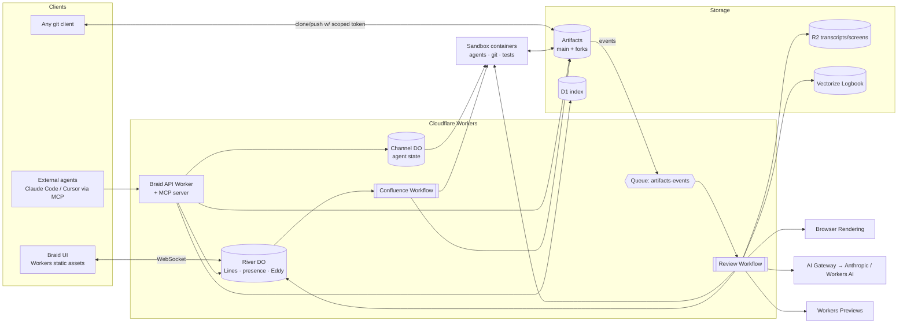

# Braid: build plan

**Many agents. One river.**
A Git platform for the agentic era, built on Cloudflare Workers and Artifacts.

*Modern Zen Strategies · draft v0 for Sedale's review · Oct 12, 2026*

> **Deadline: submissions close Wed Oct 14, 2026.** That leaves about 48 hours of build time. Artifacts billing also starts Oct 15, so the demo account needs a spend cap. Everything below is scoped to fit that window. The *cut line* in §7 is the part that matters most.

---

## 0. What Cloudflare is actually asking for

From the announcement post:

- **Hard minimum:** "multiple agents working on changes concurrently."
- **What they don't want:** "GitHub as it exists today with agents added on top."
- **Questions they want answered:**
  - How do agents know what other agents are working on?
  - What happens when changes conflict?
  - How do you review everything agents produce?
  - How do you keep track of *why* a change was made, and not only *what* changed?
  - How do you compare multiple changes at once and decide which one ships?
- **Submission:** a 5–10 minute video, source code under MIT/Apache/BSD, and run instructions.
- **Prize:** top 3 teams get up to 2 people flown to Cloudflare Connect in SF. 1st place also gets $25k in credits and the VIP speaker dinner.

**How I read the judging.** The judges are Cloudflare product people. They will reward:

1. Real use of the *new* Artifacts features: fork-per-task, events, repo-scoped tokens, Workers Builds/Previews, metrics.
2. A clear answer to each question above.
3. A demo that *looks* like the future, not like a CRUD app.

Breadth across the Cloudflare platform scores well, but only if every primitive is load-bearing and none is decoration.

---

## 1. The thesis (the Modern Zen part)

GitHub was designed around a scarce resource: **human hands**. Every feature (branches, PRs, review requests, notifications) exists to coordinate a few people typing.

Agents make hands abundant. Spinning up 50 attempts at a task costs almost nothing. The resource that becomes scarce is **human attention and judgment**. A Git platform built for the agentic era should optimize for that.

**Calm hands, fast water.** The water (the agents) moves fast and in many channels at once. The human stays calm. They read the river, pick the line, and make the few decisions that matter. The platform's job is to turn a thousand agent pushes into the one decision that needs a person.

This ties directly to the 1-hour-per-business-per-week delegation thesis. Braid is that idea applied to software itself.

### The metaphor

A **braided river** splits into many shallow channels that run side by side, shift, and rejoin downstream. That is exactly the shape of agentic development: one mainline fans out into many parallel attempts, which are compared, pruned, and rejoined.

**Rule for the vocabulary:** river words name the *nouns* in the product. All UI copy stays plain and declarative. No cleverness in sentences, matching the modernzen.co register.

| Braid term | Plain meaning | Built on |
|---|---|---|
| **River** | A project: the mainline repo plus everything flowing into it | Artifacts repo + `River` Durable Object |
| **Intent** | A unit of work: a goal plus acceptance checks. Replaces the issue/PR pair | D1 row + Workflow |
| **Channel** | One agent's attempt at an Intent, in its own forked repo | `repo.fork()` per attempt |
| **Line** | A declared claim on files/areas an agent plans to touch. "Reading the line" | `River` DO, live over WebSocket |
| **Scout** | Side-by-side comparison of channels with live previews, tests, a diff, and a judge's verdict | Workers Previews + Browser Rendering + review agent |
| **Confluence** | The merge queue, where a channel rejoins main and conflicts are resolved by an agent | Workflow + Sandbox |
| **Logbook** | The versioned *why*: plan, transcript summary, and decisions for every commit | A context file inside each channel repo, plus Vectorize |
| **Eddy** | The human inbox. Only decisions that need a person land here | `River` DO + WebSocket UI |

`Braid` is a working name. Collisions and alternatives are in §11.

---

## 2. The core loop (what the demo shows)

```
Intent ──► fan-out ──► N Channels (forks) ──► agents work concurrently
                              │                    │ declare Lines (claims)
                              │                    │ push commits + Logbook
                              ▼                    ▼
                     push events (Queues) ──► review Workflow per push
                              │                    │ tests in Sandbox
                              │                    │ preview deploy + screenshot
                              ▼                    ▼
                           Scout  ── judge ranks channels ──► winner
                                                     │
                                  Confluence (merge queue) ◄┘
                                    │ auto-resolve conflicts (agent)
                                    │ re-test, re-preview
                                    ▼
                     low risk → merge to main     high risk → Eddy (1 human decision)
```

1. **Open an Intent.** "Add rate limiting to the API," with acceptance checks such as "tests pass; 429 returned after 10 req/s." This can come from the UI, the MCP tool, or a plain `git push` of an `intents/*.md` file.
2. **Fan out.** Braid forks main into *N* Channels (default 3). Each gets a short-lived write token and runs a different agent, model, or strategy. Artifacts makes a repo per attempt cheap; that is the point of the product.
3. **Read the line.** Before editing, each agent declares the files/areas it expects to touch. The `River` Durable Object holds every live Line across every Intent. Overlaps are flagged instantly and broadcast to the agents (and the UI), so agents can avoid or sequence. *This answers "how do agents know what others are doing."*
4. **Push with a Logbook.** Every commit carries trailers (`Braid-Intent:`, `Braid-Channel:`, `Braid-Logbook:`) pointing to a context file in the same repo: plan, key decisions, rejected approaches, and model used. The *why* is versioned with the code, forkable, and clonable. *This answers "why was this change made."*
5. **React to every push.** Artifacts `repo.pushed` events → Queue → a review Workflow: run tests in a Sandbox, deploy a preview, screenshot it, and have a review agent score risk.
6. **Scout.** All Channels for an Intent appear side by side: live preview links, screenshots, test results, diff size, cost, and the judge agent's ranked verdict with reasons. *This answers "compare multiple changes and decide which ships."*
7. **Confluence.** The winner goes into the merge queue. If main moved underneath it, a merge agent rebases and resolves conflicts *in a new fork* (never in place), re-tests, and re-previews. *This answers "what happens with conflicting changes."*
8. **Eddy.** Low-risk, green, judge-confident changes merge automatically. Anything else becomes a single card in the Eddy, e.g. "Pick between these two; here's why they differ." The headline metric on screen: **"9 agents · 41 commits · 1 decision for you."** *This answers "how do you review everything."*
9. **Replay.** Any Channel at any commit can be forked into a new Channel ("rerun from here with a different model"). This is time travel for agent work. It falls out of Artifacts for free, and it's a great demo moment.

---

## 3. Cloudflare integration map: where each primitive earns its place

| Primitive | Role in Braid | Why it's not decoration |
|---|---|---|
| **Artifacts** (binding) | Mainline repos, a fork per Channel, scoped tokens, `readFile`/`log`/`readTree` for UI and review | The whole product is "a repo per attempt." Forks, not branches, give agents total isolation and scoped credentials |
| **Artifacts events** | `repo.pushed`, `repo.forked`, `token.created` → Queues | The heartbeat. Everything reacts to pushes; no polling, no webhooks to manage |
| **Workers Builds + Previews** | Push to a Channel → preview URL | Scout shows *running* software, not just diffs. (Fallback: Workers for Platforms, see §9) |
| **Durable Objects** (SQLite) | `River` per project (Lines, presence, Eddy, live feed); `Channel` per attempt (agent state) | Real-time coordination needs a single strongly consistent point per project, which is exactly what a DO is |
| **Agents SDK** | `RiverAgent` / `ChannelAgent` classes, WebSocket state sync to the UI, scheduling, plus an MCP server so outside agents can join | External agents (Claude Code, Cursor, Codex) can join a River through MCP and get Lines, tokens, and the Logbook API |
| **Workflows** | Review pipeline per push; Confluence merge queue | Durable, retryable, multi-step. Merges must survive failures mid-flight |
| **Queues** | Event fan-in from Artifacts; backpressure for hundreds of concurrent pushes | The official event-subscription delivery path |
| **Sandbox SDK** (containers) | Runs the coding agents (Claude Code headless), `git rebase/merge`, and test suites | The Artifacts binding has no merge/diff API. Real Git ops and tests need a real filesystem |
| **ArtifactFS** | Mounts a Channel repo in the Sandbox without waiting for a full clone | Faster agent cold starts. Good stretch detail for the video |
| **Dynamic Workers** (Worker Loader) | *Stretch:* runs a candidate's Worker code in an isolate in milliseconds for instant smoke tests before a full build | Shows the fastest feedback loop on the platform |
| **Browser Rendering** | Screenshots each preview for Scout's visual compare | Lets a human judge 5 UIs in 5 seconds |
| **Workers AI + AI Gateway** | Cheap review/risk model and embeddings; Gateway fronts Anthropic for the coding agents with per-Channel cost tracking | "Cost" becomes a column in Scout. Budget-aware agents fit the Modern Zen model |
| **Vectorize** | Semantic index of Logbooks, so you can ask "why does the API rate-limit at 10 req/s?" and get the commit plus its reasoning | Turns agent context into institutional memory |
| **D1** | Cross-project index: Rivers, Intents, Channels, verdicts | Queries across Rivers (DOs are per River) |
| **R2** | Full agent transcripts, screenshots, test logs | Large blobs stay out of Git, and the Logbook links to them |
| **Analytics Engine / Artifacts metrics** | River health: agents active, pushes/min, auto-merge rate, human-decision rate | The "calm" metric is a product feature |
| **Cloudflare Access** | Gates the human UI | Zero auth code to write in 48h |

### Five ideas that set Braid apart (lead the video with these)

1. **Forks, not branches.** Every attempt is its own repo with its own token. A rogue agent can't touch another agent's work or main.
2. **Lines.** Agents declare intent *before* writing. Conflict is prevented upstream, not resolved downstream.
3. **Scout.** N running previews side by side with a judge's verdict. Choosing becomes the human's job, not reading diffs.
4. **Logbook in the repo.** The *why* lives in Git, versioned, forkable, and searchable semantically. Context travels with the code.
5. **Eddy: one decision.** The platform measures itself by how *few* human decisions it needs.

---

## 4. Architecture



**Repo naming in Artifacts** (namespace `braid`):
- `river-<slug>`: mainline
- `river-<slug>--ch-<intentId>-<n>`: Channel forks
- `river-<slug>--cf-<intentId>`: Confluence (merge-resolution) forks

**Commit trailers (the agent protocol on the wire):**
```
Braid-Intent: int_8f2c
Braid-Channel: ch_8f2c_2
Braid-Agent: claude-code/sonnet · strategy=minimal-diff
Braid-Logbook: .braid/logbook/ch_8f2c_2.md
```

**MCP tools exposed to agents** (Agents SDK `McpAgent`):
`river.join`, `intent.list`, `intent.open`, `channel.start` (returns remote + scoped token + `AGENTS.md`), `line.declare`, `line.release`, `logbook.write`, `channel.submit`, `river.ask` (semantic Logbook search).

---

## 5. Data model (minimum)

- **River** `{id, slug, mainRepo, policy: {autoMergeRisk, channelsPerIntent, judgeModel}}`
- **Intent** `{id, riverId, title, goal, checks[], status: open|running|scouting|confluence|merged|eddy}`
- **Channel** `{id, intentId, repo, agent, strategy, status, headSha, previewUrl, screenshotKey, tests, risk, costUsd}`
- **Line** `{channelId, paths[] (globs), note, declaredAt}`, kept live in River DO SQLite
- **Verdict** `{intentId, rankedChannels[], rationale, judgeModel}`
- **EddyCard** `{id, riverId, kind: choose|approve|resolve, payload, decidedBy, decidedAt}`

---

## 6. The demo River

A small, visual Cloudflare Worker app, so previews look meaningfully different: **"Riverlevels,"** a one-page gauge dashboard for a few named rivers (mock data). It's small, fast to build, visual, and on-brand.

**Demo Intents (fire all at once):**
1. *"Add a dark mode"*: 3 Channels with different design strategies. Scout's visual compare shines here.
2. *"Add rate limiting to /api"*: 3 Channels. Tests decide the winner.
3. *"Refactor the gauge component"*: 3 Channels, deliberately overlapping Intent 1's files, so **Lines** flag it live and **Confluence** must resolve a real conflict.

That is 9 concurrent agents, which comfortably clears the "multiple agents concurrently" bar on camera.

---

## 7. Scope: the cut line

**MUST (the submission fails without these)**
- [ ] Rivers, Intents, fan-out to N forked Channels via the Artifacts binding
- [ ] Agents running concurrently in Sandboxes, pushing to their forks with scoped tokens
- [ ] Push events → Queue → review Workflow (tests + risk score)
- [ ] Lines: declare/overlap detection in River DO, live in the UI
- [ ] Scout view: Channels side by side with diff stats, tests, and judge verdict
- [ ] Confluence: merge the winner to main (rebase in Sandbox; agent resolves conflicts)
- [ ] Logbook trailers + file per Channel, rendered in UI
- [ ] Eddy inbox with the "N agents · M commits · K decisions" header
- [ ] MIT license, README with run instructions, 5–10 min video

**SHOULD (big demo value, moderate cost)**
- [ ] Preview URLs per Channel + Browser Rendering screenshots in Scout
- [ ] MCP server so an external Claude Code session can join a River live on camera
- [ ] Replay: fork any Channel at any commit
- [ ] AI Gateway cost per Channel

**STRETCH (only if ahead)**
- [ ] Vectorize "ask the river why"
- [ ] Dynamic Workers instant smoke test
- [ ] ArtifactFS mount for agent cold start
- [ ] Landing page deployed on the same Worker (the Claude Design output)

**Reliability guardrail:** ship a **`BRAID_AGENT_MODE=scripted`** fallback in which each Channel applies a pre-recorded patch series with realistic timing. The live agent path is the real product, but the video can't depend on 9 LLM runs behaving perfectly on take one. Use live mode for at least one Intent on camera and say so honestly.

---

## 8. 48-hour schedule

All times are Pacific. Submit by the evening of **Wed Oct 14**, not at midnight.

| When | Block | Output |
|---|---|---|
| **Mon pm** (today) | Account setup on the Modern Zen Cloudflare account (`sedale@drp.icu`): Workers Paid, Artifacts beta enabled, `braid` namespace, spend cap. Run the Claude Design prompt in parallel | Account ready; design direction locked |
| **Mon night** | Claude Code session 1: scaffold, Artifacts binding, River/Intent/Channel fan-out, event Queue, scripted agent mode end to end | Forks created; pushes flowing; events land |
| **Tue am** | Session 2: Lines (River DO + WebSocket), review Workflow (Sandbox tests + risk), Logbook trailers | Live coordination works |
| **Tue pm** | Session 3: Scout + Confluence + Eddy; port the Claude Design screens into the UI | Full loop on the demo River |
| **Tue night** | Session 4: live agent mode (Claude Code in Sandbox via AI Gateway), previews + screenshots, MCP server | SHOULD items |
| **Wed am** | Hardening, README, seed script, landing page live | Repo public on GitHub |
| **Wed pm** | Record video (script in §10), edit, submit | **Submitted** |

Parallelism: Claude Code cloud agents can split the work (UI vs Workers backend vs demo app) once the scaffold lands. That is also a fitting way to build this product.

---

## 9. Risks and unknowns

| Risk | Likelihood | Mitigation |
|---|---|---|
| Artifacts binding has no `diff`/`merge`/branch APIs (docs list: create/get/list/import/delete, fork, log, readCommit/readTree/readBlob/readFile, tokens) | Certain | All Git working-tree ops run in the Sandbox with standard `git`. The binding handles lifecycle, tokens, and reads |
| Workers Builds may not be programmatically attachable to each new fork | Medium | Fallback: the review Workflow runs `wrangler deploy --dispatch-namespace braid-previews` (Workers for Platforms) from the Sandbox, giving each Channel its own user Worker URL |
| Sandbox cold starts slow down 9 parallel agents | Medium | Pre-warm Sandboxes when an Intent opens; ArtifactFS if time allows; scripted mode for the video |
| Account not on Workers Paid / Artifacts not enabled on `sedale@drp.icu` | Unknown | First 30 minutes of setup. Verify before writing code |
| Artifacts billing starts Oct 15 | Certain | Low volume. Set a usage alert; delete demo forks after judging if needed |
| LLM cost of 9 concurrent agents | Low–Med | AI Gateway caching + cost caps per Channel; Sonnet-class model for workers, Workers AI for review |
| Event payload shape mismatches docs (beta) | Medium | Log raw events to R2 on day 1; code against what actually arrives |

---

## 10. Video outline (8 minutes)

1. **0:00 The question (45s).** "GitHub was built for scarce hands. Agents made hands abundant. What's scarce now is your attention." Braided river aerial footage.
2. **0:45 One Intent, three channels (90s).** Open "Add dark mode." Three forks appear and three agents start. Show the forks in the Artifacts dashboard to prove they're real.
3. **2:15 Reading the line (60s).** Fire the overlapping Intent. Lines collide live. One agent yields and re-plans.
4. **3:15 Scout (90s).** Three running previews side by side, screenshots, tests, cost, and the judge's verdict. Pick one in one click.
5. **4:45 Confluence (60s).** Main moved; a merge agent resolves in a fresh fork; green; merged.
6. **5:45 Logbook and replay (60s).** Click a line of code → commit → Logbook explains why. Fork from commit 3 with a different model.
7. **6:45 External agent joins (45s).** A live Claude Code session joins the River via MCP and picks up an Intent.
8. **7:30 Eddy (30s).** "9 agents · 41 commits · 1 decision for you." Close: *Calm hands, fast water.*

The architecture slide goes in the README, not the video.

---

## 11. Decisions for you

1. **Name.** `Braid` is the working name. Note that Braid is also an existing IETF HTTP sync protocol (braid.org), so search results will collide. Alternatives in the same metaphor: **Headwaters**, **Watershed**, **Riverbed**, **Confluence** (clashes with Atlassian, so no). My pick is *Braid* for the video and *Headwaters* if you want something ownable as a Modern Zen product later.
2. **Public source home.** GitHub `Modern-Zen/braid` (MIT) as the public link. The repo itself will also be imported into Artifacts, so Braid hosts its own development. That's a nice detail for the video.
3. **Domain.** Suggest `braid.drp.icu` (keeps it under the agent-entrance domain on the same Cloudflare account) or a `*.workers.dev` URL for speed.
4. **Team for the SF trip.** Up to 2 people get flown out. Decide whether to name a second team member on the submission.
5. **Agent runtime for live mode.** Claude Code headless in Sandbox (recommended; strongest demo) vs a lighter in-Worker agent loop.

---

## 12. Plan for the two deliverables

These are written **after** you sign off on §1–§11, so they encode your decisions.

### A. Claude Design prompt → `prompts/claude-design.md`

**Goal:** a landing page that sells the idea in 10 seconds, plus 4 core app screens, so the product looks finished on camera.

**Contents of the prompt:**
- **Brand frame:** Modern Zen with "calm hands, fast water." Pull the exact palette and type from `# Brand Strategy.txt` in the modernzen client folder if you want strict on-brand; otherwise use the direction below.
- **Visual direction:** aerial braided-river topography as the core motif, drawn as fine generative line work where channels split and rejoin. Make it ink-on-paper calm, not neon "AI." Proposed palette: glacial teal, slate, river-stone greys, warm paper white, and one signal color (sunlit amber) reserved for "needs a human." A confident serif display face paired with a clean grotesk and a mono for code/hashes. Lots of air.
- **Landing page sections:**
  1. Hero: "Many agents. One river." with an animated braid (channels fork from a mainline, run in parallel, rejoin)
  2. The shift: scarce hands → scarce attention
  3. The five ideas (Forks · Lines · Scout · Logbook · Eddy), each with a small diagram
  4. The live counter "9 agents · 41 commits · 1 decision"
  5. "Built on Cloudflare" primitives strip (Artifacts, Workers, Durable Objects, Workflows, Sandboxes)
  6. For agents: the MCP join snippet and `git clone` with a scoped token
  7. Open source (MIT) + CTA
- **App screens:** River overview (live channel map), Scout (N previews side by side + verdict), Eddy inbox, Logbook/commit view. Include the empty, running, conflict, and merged states.
- **Output asks:** design tokens (CSS variables) so Claude Code can port them 1:1, desktop + mobile, light + dark.

### B. Claude Code prompt → `prompts/claude-code.md`

**Goal:** one prompt that can run as the first session and also be handed to parallel cloud agents per workstream.

**Contents of the prompt:**
- Mission and the thesis in 5 lines (the agent should understand *why* forks and Lines exist)
- Exact stack: TypeScript, Wrangler ≥ 4.145, Agents SDK, Artifacts binding (`namespace: "braid"`), DO SQLite, Workflows, Queues + Artifacts event subscription, Sandbox SDK, D1, R2, AI Gateway; UI with React + Vite served as Worker static assets
- Monorepo layout: `apps/worker`, `apps/ui`, `apps/demo-riverlevels`, `packages/protocol` (trailers, MCP schema), `scripts/` (seed, demo)
- The Artifacts API surface *verbatim from the docs* (so it doesn't hallucinate methods), plus an explicit note that diff/merge happen in the Sandbox
- Build order matching §8, with acceptance tests per milestone
- `BRAID_AGENT_MODE=scripted|live` requirement
- Rules: PowerShell for every local command in docs and README; MIT license; no secrets in repo; log raw Artifacts events to R2 on day 1
- Deliverables: working deploy, seed script that creates the demo River + 3 Intents, README with run instructions, `docs/ARCHITECTURE.md`

---

## 13. Account setup (run first, PowerShell)

```powershell
# Log in to the Modern Zen account (sedale@drp.icu) in the browser prompt
npx wrangler@latest login
npx wrangler whoami            # confirm the Modern Zen account ID

# Verify Artifacts access and create the namespace's first repo as a smoke test
npx wrangler artifacts --help
npx wrangler artifacts repos create braid-smoke --namespace braid
npx wrangler artifacts repos issue-token braid-smoke --namespace braid
```

Then, in the dashboard: confirm the account has **Workers Paid**, enable **Sandbox/Containers**, create a **Workers for Platforms** dispatch namespace `braid-previews` (fallback path), set a **billing notification**, and create an **AI Gateway** named `braid`.

*Exact `artifacts` subcommand flags should be checked against `--help`. The docs confirm `repos issue-token` exists; other flags are my best reading.*

---

**Sources:** [Cloudflare blog: build the next Git platform](https://blog.cloudflare.com/next-git-platform-on-cloudflare/) · [Artifacts docs](https://developers.cloudflare.com/artifacts/) · [Workers binding](https://developers.cloudflare.com/artifacts/api/workers-binding/) · [Event subscriptions](https://developers.cloudflare.com/artifacts/guides/event-subscriptions/) · [ArtifactFS](https://developers.cloudflare.com/artifacts/guides/artifact-fs/) · [Sandbox SDK + Artifacts](https://developers.cloudflare.com/artifacts/examples/sandbox-sdk-artifacts/) · [Build and deploy](https://developers.cloudflare.com/artifacts/guides/build-and-deploy-on-push/) · [Limits](https://developers.cloudflare.com/artifacts/platform/limits/) · [Dynamic Workers](https://developers.cloudflare.com/workers/runtime-apis/bindings/worker-loader) · [Agents Week summary](https://lilting.ch/en/articles/cloudflare-agents-week-sandboxes-facets-unified-cli)

*—Modern Zen Strategies*
